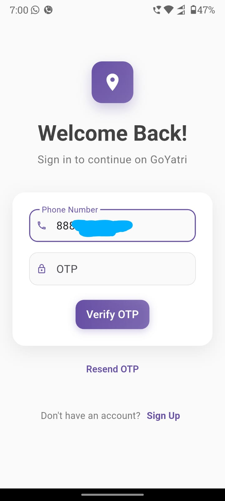
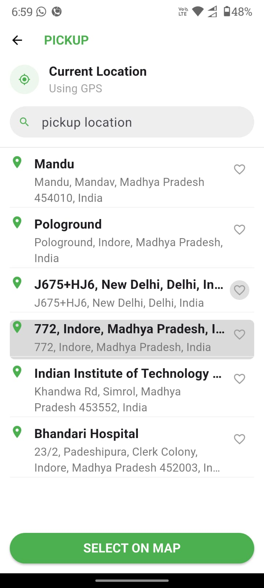
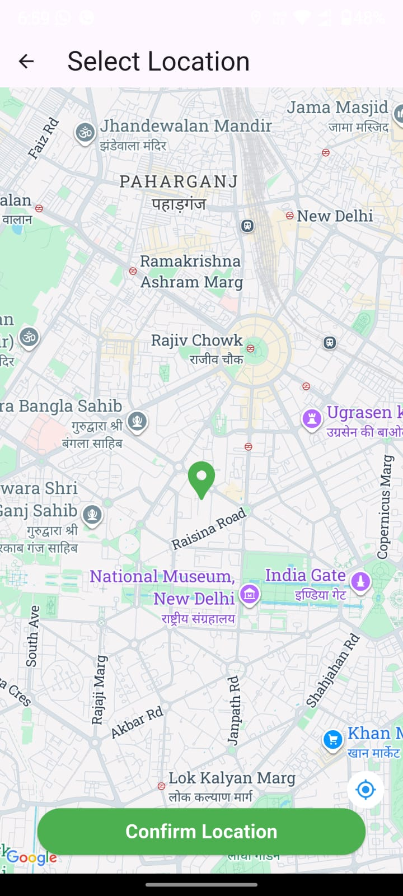
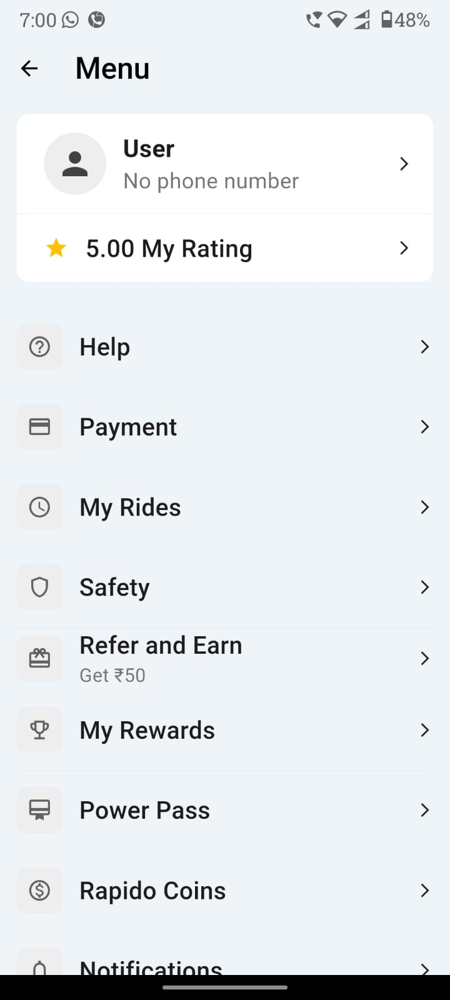

# 🚗 GoYatri - Smart Transportation Flutter App

**GoYatri** is a comprehensive cross-platform Flutter application designed for intelligent transportation selection and location management. Built with clean architecture principles, it provides seamless location-based services across Android, iOS, and web platforms.

[](https://flutter.dev)
[](https://firebase.google.com)
[](LICENSE)

## ✨ Features

### 🗺️ **Location Services**
- **Smart Location Selection**: Search, recent locations, favorites, and map-based selection
- **GPS Integration**: Real-time current location detection with permission handling
- **Interactive Maps**: Google Maps integration with custom markers and styling
- **Route Visualization**: Dynamic polyline drawing for path representation
- **Geocoding**: Address-to-coordinates conversion and reverse geocoding

### 🔐 **Authentication & User Management**
- **Firebase Authentication**: Email/password and Google sign-in integration
- **User Session Management**: Secure login state persistence
- **Authentication Flow**: Splash screen with automatic login detection

### 🔔 **Notifications**
- **Local Notifications**: Flutter local notifications for app events
- **Permission Management**: Runtime permission requests for location and notifications

### 🎨 **User Interface**
- **Modern Material Design**: Consistent UI/UX across all platforms
- **Responsive Layout**: Optimized for different screen sizes
- **Custom App Icons**: Platform-specific launcher icons
- **Portrait Lock**: Optimized mobile experience

### ⚙️ **Additional Features**
- **State Persistence**: SharedPreferences for user preferences
- **Clean Architecture**: Feature-based modular code organization
- **Multi-platform Support**: Android, iOS, Web, Windows, macOS, Linux
- **CI/CD Integration**: Automated build workflows for Android APK and iOS

## 📱 Screenshots

<table>
  <tr>
    <td align="center">
      
      <br><b>Splash Screen</b>
    </td>
    <td align="center">
      
      <br><b>Authentication</b>
    </td>
    <td align="center">
      
      <br><b>Home Dashboard</b>
    </td>
  </tr>
  <tr>
    <td align="center">
      
      <br><b>Location Picker</b>
    </td>
    <td align="center">
      
      <br><b>Map Integration</b>
    </td>
    <td align="center">
      
      <br><b>Navigation Menu</b>
    </td>
  </tr>
</table>

## 🛠️ Tech Stack

### **Core Framework**
- **Flutter SDK**: ^3.8.1
- **Dart**: Latest stable version

### **State Management & Navigation**
- **Provider**: ^6.1.5 (Primary state management)
- **GetX**: ^4.7.2 (Navigation and routing)

### **Firebase Services**
- **firebase_core**: ^4.0.0
- **firebase_auth**: ^6.0.0

### **Maps & Location**
- **google_maps_flutter**: ^2.12.3 (Android/iOS maps)
- **google_maps_flutter_web**: ^0.5.12+2 (Web support)
- **google_places_flutter**: ^2.1.0 (Places API integration)
- **flutter_polyline_points**: ^3.0.1 (Route visualization)
- **geolocator**: ^14.0.2 (GPS location services)
- **geocoding**: ^4.0.0 (Address conversion)
- **permission_handler**: ^12.0.1 (Runtime permissions)

### **Storage & Persistence**
- **shared_preferences**: ^2.5.3 (Local storage)

### **Networking & Utilities**
- **dio**: ^5.8.0+1 (HTTP client)
- **uuid**: ^4.5.0 (Unique identifier generation)
- **intl**: ^0.19.0 (Internationalization)

### **Notifications**
- **flutter_local_notifications**: ^19.4.0

### **Development Tools**
- **icons_launcher**: ^3.0.1 (App icon generation)
- **flutter_lints**: ^5.0.0 (Code quality)

## 🏗️ Project Architecture

```
lib/
├── main.dart                    # App entry point
├── routes/                      # App routing configuration
├── features/                    # Feature modules (Clean Architecture)
│   ├── auth-firebase/          # Firebase authentication
│   │   ├── presentation/       # UI controllers & pages
│   │   └── ...
│   ├── home/                   # Home dashboard
│   ├── location/               # Location services
│   │   ├── data/              # Data sources & repositories
│   │   ├── domain/            # Business logic & entities
│   │   └── presentation/      # UI & controllers
│   ├── map/                    # Map integration
│   └── splash/                 # Splash screen
├── core/                       # Core utilities & constants
├── services/                   # Shared services
│   └── notification_service.dart
├── storage/                    # Local storage utilities
├── wrapper/                    # App wrapper components
└── asset_loader/              # Asset management

assets/
├── icons/                      # App icons & UI assets
│   └── app_icon.png           # Main app icon
└── map/
    └── map_style.json         # Custom map styling

.github/
└── workflows/                  # CI/CD automation
    ├── apk_build_workflow.yml # Android APK builds
    └── ios_build_workflow.yml # iOS app builds
```

## 🚀 Getting Started

### Prerequisites
- **Flutter SDK**: >=3.8.1
- **Dart SDK**: >=3.0.0
- **Android Studio** / **VS Code** with Flutter extensions
- **Firebase Project** with Authentication enabled
- **Google Maps API Key**

### Installation

1. **Clone the repository**
   ```bash
   git clone https://github.com/anilsjr/go-yatri.git
   cd go-yatri
   ```

2. **Install dependencies**
   ```bash
   flutter pub get
   ```

3. **Configure Firebase**
   - Add your `google-services.json` (Android) and `GoogleService-Info.plist` (iOS)
   - Update Firebase configuration in the app

4. **Configure Google Maps**
   - Add your Google Maps API key to:
     - `android/app/src/main/AndroidManifest.xml`
     - `ios/Runner/AppDelegate.swift`
     - `web/index.html`

5. **Generate app icons**
   ```bash
   flutter pub run icons_launcher:create
   ```

6. **Run the application**
   ```bash
   flutter run
   ```

### Build for Production

**Android APK:**
```bash
flutter build apk --release
```

**iOS App:**
```bash
flutter build ios --release
```

**Web:**
```bash
flutter build web --release
```

## 🔧 Configuration

### Firebase Setup
1. Create a new Firebase project
2. Enable Authentication (Email/Password and Google)
3. Add your app's SHA-1 fingerprint for Android
4. Download configuration files and add to respective platform folders

### Google Maps API
1. Enable Google Maps SDK for Android/iOS in Google Cloud Console
2. Enable Places API for location search functionality
3. Add API keys to platform-specific configuration files

⚠️ **Security Note**: The API keys in this repository have been deactivated. Use your own API keys for development and production.

## 🔄 CI/CD Workflows

The project includes automated GitHub Actions workflows:

- **Android Build**: Automated APK generation on push/PR
- **iOS Build**: Automated iOS app builds with proper provisioning
- **Release Management**: Automated uploads to GitHub releases

## 🤝 Contributing

We welcome contributions! Please follow these steps:

1. **Fork the repository**
2. **Create a feature branch**
   ```bash
   git checkout -b feature/amazing-feature
   ```
3. **Make your changes and commit**
   ```bash
   git commit -m 'Add some amazing feature'
   ```
4. **Push to your branch**
   ```bash
   git push origin feature/amazing-feature
   ```
5. **Open a Pull Request**

### Code Style Guidelines
- Follow Flutter/Dart style guidelines
- Use meaningful commit messages
- Add documentation for new features
- Ensure all tests pass before submitting

## 📝 License

This project is licensed under the **MIT License** - see the [LICENSE](LICENSE) file for details.

## 👨‍💻 Author

**Anil Vishwakarma**
- GitHub: [@anilsjr](https://github.com/anilsjr)
- Portfolio: [anilvk.me](http://anilvk.me)
- Email: anil.vishwakarma.it@gmail.com

## 🙏 Acknowledgments

- Flutter team for the amazing framework
- Firebase for backend services
- Google Maps for location services
- Open source community for valuable packages

---

<div align="center">
  <b>⭐ Star this repository if you find it helpful!</b>
</div>